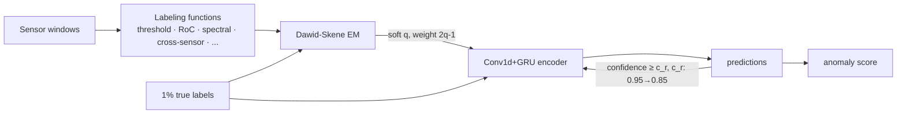
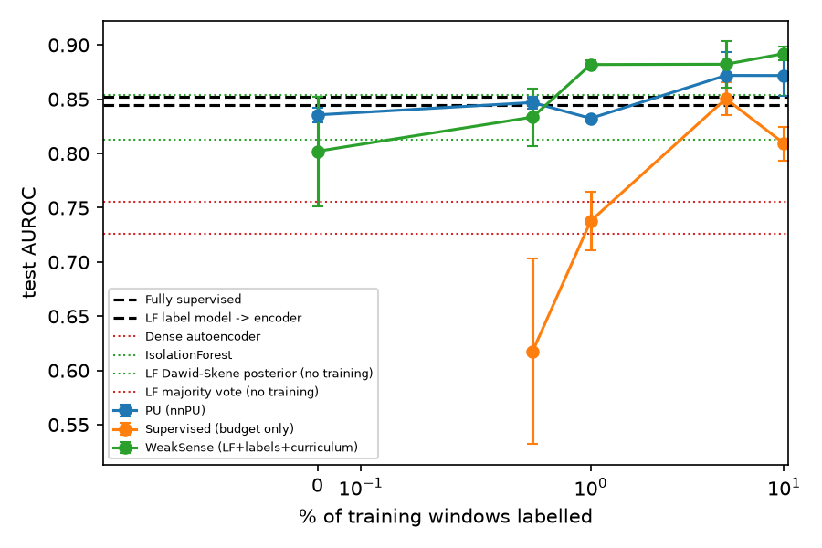
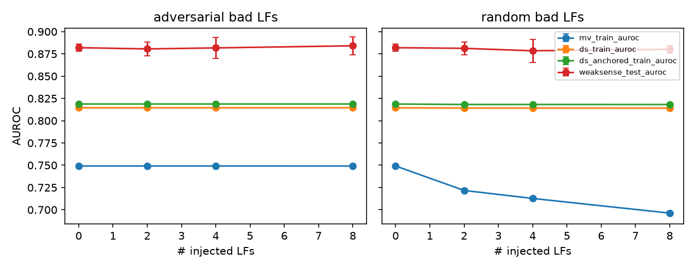
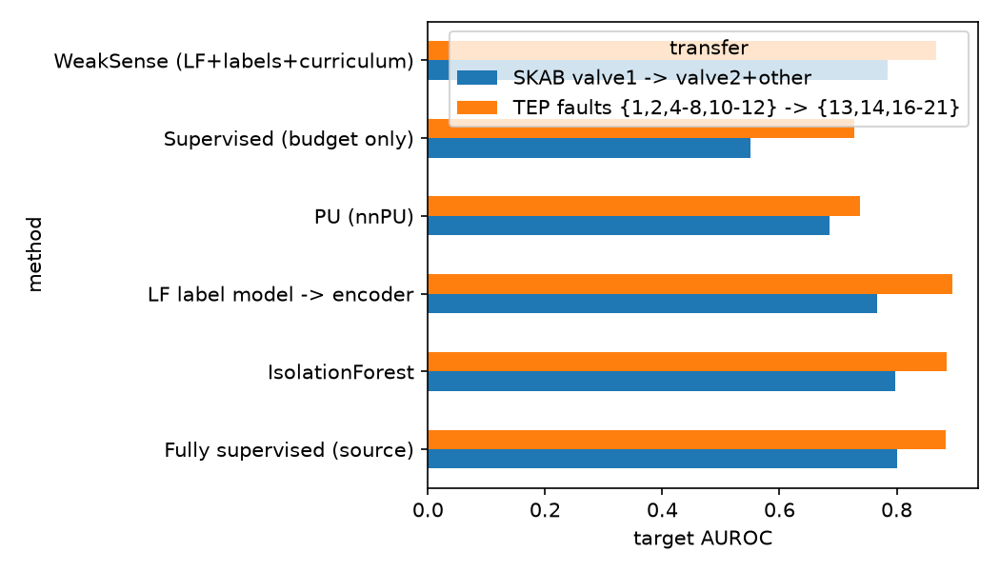
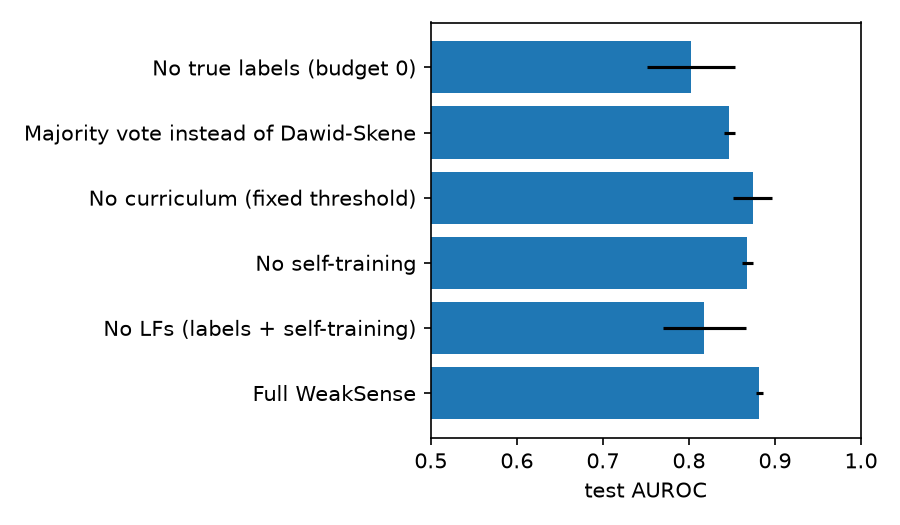

# WeakSense — Weakly-Supervised Anomaly Detection for Industrial Sensor Streams

**Author:** Hossein Tabasi · MIT License

Plant engineers rarely label anomalies, but they *can* state rules: "flag it if any sensor drifts more than 5σ from the run's
reference", "the sensors stop agreeing with each other", "the variance bursts". WeakSense turns such **labeling functions (LFs)**
into probabilistic training labels with a Dawid–Skene label model. It **anchors** the label model with a tiny budget of true labels
(0.5–10%) and trains a Conv1d+GRU window encoder with **noise-aware soft targets and confidence-curriculum self-training**.

## Method
1. **Windows.** Each window is x ∈ ℝ^{L×d} (L = 32), z-normalized by the first `reference` = 100 samples of its run, which are
   treated as known normal start-up data.
2. **LFs.** 7 generic LFs plus one threshold LF per sensor (`src/weaksense/lfs.py`). Each outputs {1, 0, abstain}:
   - an any-sensor > 5σ threshold
   - an all-within-2σ "normal" vote
   - rate-of-change
   - cross-sensor inconsistency (ridge model of each sensor from the others)
   - high-frequency spectral share
   - mean shift
   - variance burst
3. **Label model.** Dawid–Skene EM with per-LF confusion matrices, so that
   q_i = P(y_i = 1 | Λ_i) ∝ π ∏_j P(λ_ij | y = 1).
   Revealed labels are **clamped** in the E-step (anchors), which pins the LF accuracies.
4. **Encoder.** It is trained with weighted BCE: target q_i, weight w_i = |2q_i − 1|, and weight 3 for the true labels.
5. **Curriculum self-training.** Run R = 3 rounds. In each round, windows with max(p, 1−p) ≥ c_r become pseudo-labels, where
   c_r decays linearly from 0.95 to 0.85.



## Data
- **SKAB** (Skoltech Anomaly Benchmark, <https://github.com/waico/SKAB>): 34 runs, 8 sensors, labelled anomalies. Runs with an even
  index are used for training and odd for test (9 079 / 9 102 windows, anomaly rate 0.349 / 0.369, stride 2).
- **TEP** (Braatz files, <https://github.com/camaramm/tennessee-eastman-profBraatz>), used for E4 only, with stride 4.

## Quickstart
```bash
pip install -r requirements.txt && pip install -e .
bash scripts/download_data.sh && export INDUSTRIAL_TS_DATA=data/raw
python3 -m pytest -q                 # 8 tests
python3 scripts/run_all.py E1 E2 E3 E4 E5   # ≈80 min CPU (each Ek can be run separately)
python3 scripts/aggregate.py         # summaries, figures, reports/RESULTS.md
```

## Results (SKAB test runs unless stated; seeds 0,1,2; from `experiments/results/`)

### E1 Label-budget curve (test AUROC / AUPRC)
| Budget | Supervised (budget only) | PU (nnPU) | LF label model → encoder | **WeakSense** |
|---|---|---|---|---|
| 0 % | — | 0.836 ± 0.007 | **0.845 ± 0.008** / 0.747 | 0.802 ± 0.051 / 0.661 |
| 0.5 % | 0.617 ± 0.086 | **0.847 ± 0.005** | — | 0.834 ± 0.027 / **0.752** |
| 1 % | 0.738 ± 0.027 | 0.832 ± 0.002 | — | **0.882 ± 0.004** / **0.828** |
| 5 % | 0.851 ± 0.015 | 0.872 ± 0.022 | — | **0.882 ± 0.022** / **0.837** |
| 10 % | 0.809 ± 0.015 | 0.872 ± 0.019 | — | **0.892 ± 0.006** / **0.842** |

Reference points:
- fully supervised (100 % labels): 0.852 ± 0.037
- IsolationForest: 0.854 ± 0.012
- dense AE: 0.726 ± 0.009
- LF majority vote: 0.755
- Dawid–Skene posterior alone: 0.813

With 1 % labels, WeakSense outperforms the fully supervised encoder on this split. The fully supervised encoder overfits the
even/odd run split.



### E2 LF analysis (training split)
| Label model | AUROC | AUPRC |
|---|---|---|
| Majority vote | 0.749 | 0.615 |
| Dawid–Skene EM | **0.815** | **0.709** |

Selected LFs (full table in `reports/RESULTS.md`):

| LF | Coverage | Empirical acc | Learned acc |
|---|---|---|---|
| mean_shift | 0.496 | 0.715 | 0.990 |
| variance_burst | 0.440 | 0.743 | 0.608 |
| rate_of_change > 3σ | 0.979 | 0.348 | 0.500 |
| spectral_high_freq_share > 0.6 | 0.923 | 0.358 | 0.500 |

The label model correctly assigns an uninformative 0.5 accuracy to the two noisy, high-coverage LFs, whose thresholds were fixed a
priori and were too loose for SKAB.

### E3 Robustness to injected bad LFs (k extra LFs)
| Injected | k | MV train AUROC | DS train AUROC | WeakSense test AUROC |
|---|---|---|---|---|
| random votes | 0 | 0.749 | 0.815 | 0.882 ± 0.004 |
| random votes | 8 | 0.696 | 0.814 | 0.880 ± 0.004 |
| flipped copies of the most accurate LF | 8 | 0.749 | 0.815 | 0.884 ± 0.010 |

Majority vote degrades with random LFs, while Dawid–Skene and WeakSense are essentially unaffected.



### E4 Transfer (LFs and label model rebuilt on the source; 1 % source labels; evaluated on an unseen target)
| Transfer | Supervised 1 % | PU | LF→encoder | **WeakSense** | Fully supervised (source) | IsolationForest |
|---|---|---|---|---|---|---|
| SKAB valve1 → valve2+other | 0.550 | 0.685 | 0.767 | 0.785 ± 0.038 | **0.800** | 0.797 (AUPRC **0.732**) |
| TEP faults {1,2,4–8,10–12} → {13,14,16–21} | 0.727 | 0.738 | **0.895 ± 0.011** | 0.867 ± 0.028 | 0.884 | 0.886 |



### E5 Ablation (budget 1 %)
| Variant | AUROC | AUPRC |
|---|---|---|
| **Full WeakSense** | **0.882 ± 0.004** | 0.828 |
| No curriculum (fixed threshold 0.85) | 0.874 ± 0.023 | **0.838** |
| No self-training | 0.868 ± 0.006 | 0.809 |
| Majority vote instead of Dawid–Skene | 0.847 ± 0.006 | 0.768 |
| No LFs (labels + self-training only) | 0.818 ± 0.048 | 0.806 |
| No true labels (budget 0) | 0.802 ± 0.051 | 0.661 |



## Honest findings and limitations
- In transfer (E4), WeakSense does **not** beat IsolationForest or a fully supervised source model. On TEP, the plain LF→encoder
  variant is better than full WeakSense.
- At budget 0, self-training *hurts* (0.802 vs 0.845 for the LF→encoder): with no anchors, confident mistakes get reinforced.
- The E3 "adversarial" test is weak. The most accurate LF by empirical accuracy is `all_sensors_within_2sd`, which covers only
  0.1 % of windows, so flipping copies of it barely changes anything. A stronger test would flip a high-coverage LF.
- LF thresholds were fixed a priori and not tuned on test data. Two LFs are poor on SKAB.
- SKAB has one evaluation split (even/odd runs); seeds vary the label draw and initialization, not the split.

## Citation
```bibtex
@software{tabasi2026weaksense,
  author = {Hossein Tabasi},
  title  = {WeakSense: Weakly-Supervised Anomaly Detection for Industrial Sensor Streams},
  year   = {2026},
  url    = {https://github.com/hosseinTabasi/weaksense-ts-anomaly}
}
```
References:
- A. P. Dawid, A. M. Skene, *Applied Statistics* 1979.
- A. Ratner et al., "Snorkel," VLDB 2018.
- R. Kiryo et al., "Positive-Unlabeled Learning with Non-Negative Risk Estimator," NeurIPS 2017.
- I. D. Katser, V. O. Kozitsin, "SKAB," Kaggle 2020.
